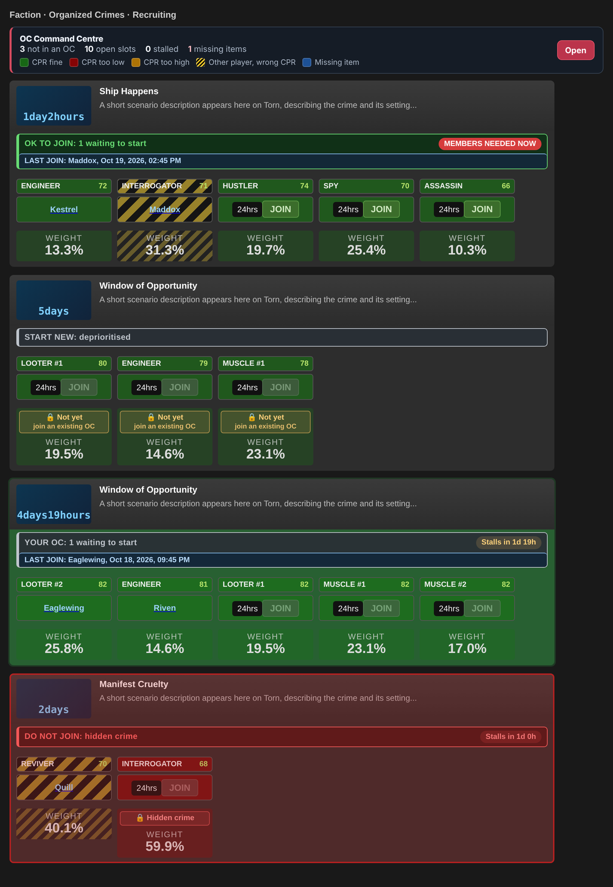
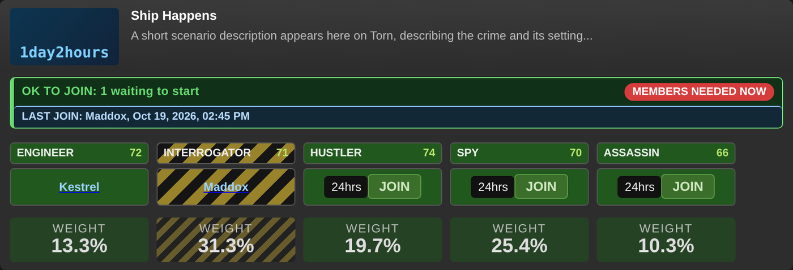
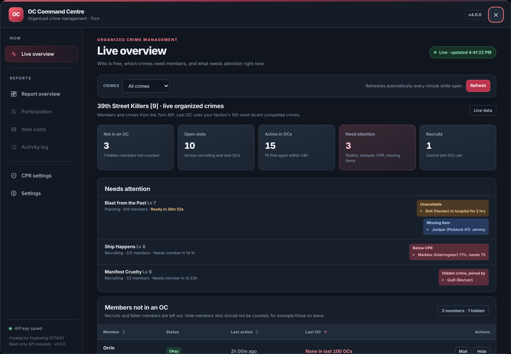
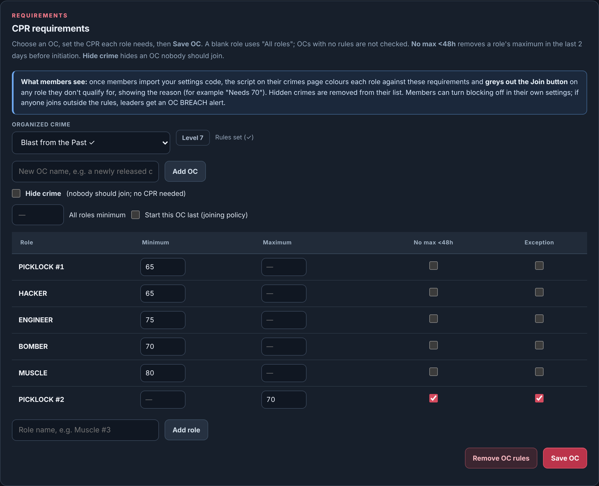
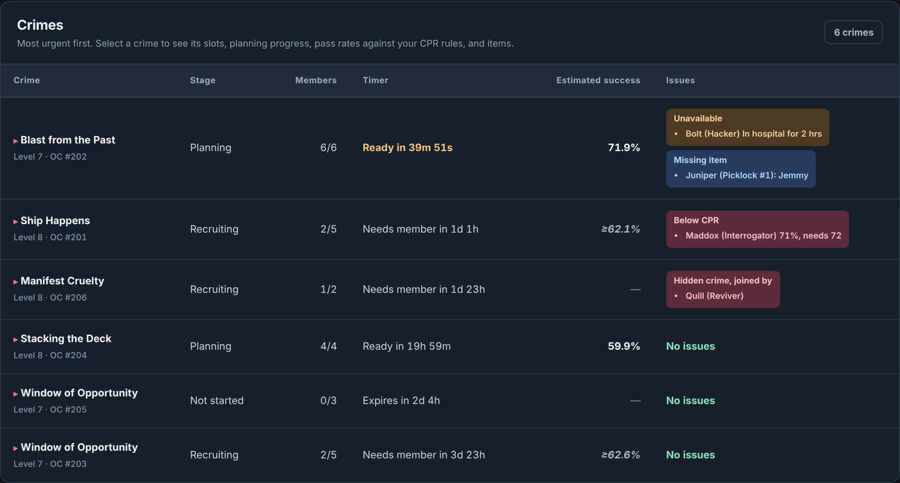
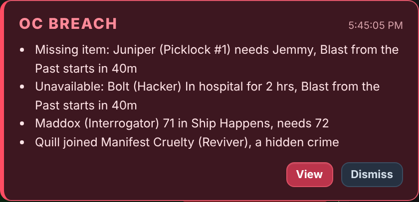

# OC Command Centre

**An organized crime toolkit for Torn factions.** Every member gets CPR rules, a status bar and smart Join blocking on the crimes page. Leaders get a live OC dashboard, reports, item costs and OC BREACH alerts, and can push CPR rules to the whole faction with a single newsletter.

No faction's rules are built in. It works for any faction in Torn.

[**Install**](https://raw.githubusercontent.com/Eaglewing91/OC-Command-Centre/main/OC-Command-Centre.user.js) · [User guide (PDF)](docs/OC-Command-Centre-Guide.pdf) · [Changelog](CHANGELOG.md) · [Forum post](docs/forum-post.txt) · [Report a problem](https://github.com/Eaglewing91/OC-Command-Centre/issues)

---

## Features

### For every member (no API key needed)

- **CPR colours on every role.** Green means you qualify, red means you're below the minimum, orange means you're above the maximum. Missing items and wrong-CPR members in a slot are highlighted too.
- **A status bar on each OC.** It shows the join status (OK TO JOIN, WAIT, START NEW, YOUR OC, DO NOT JOIN), a colour-coded stall timer ("Stalls in 3h 20m", "MEMBERS NEEDED NOW"), and LAST JOIN / JOINED TOO EARLY.
- **Join buttons that explain themselves.** A greyed-out button shows why underneath: *Needs 73 · you have 70*, *Hidden crime*, *Wait · 2 not planning*. Clicking a blocked button does nothing, so no request is made.
- **Hidden crimes.** OCs your faction doesn't run are removed from the list. If someone joins one anyway, it's marked in red.
- **Role weights** from Torn Probability.
- **Automatic rule updates.** Open your faction's newsletter and the new CPR rules import instantly, with a "What changed" summary and Undo.
- **Travel warning (optional).** Add your own Minimal API key and Torn's travel page warns you when a round trip would get you back after your OC is due to start, listing the destinations that still get you back in time.

### For leaders (Faction API access)

- **Live overview.** Members not in an OC, open slots, crimes that need attention, missing items, members in hospital or travelling, possible early joins, and Mail/Hide buttons.
- **Estimated success** on every crime, including a projection for crimes still recruiting. Optional.
- **OC BREACH alerts** anywhere in Torn: below or above CPR, a hidden crime joined, or a missing item or unavailable member on an OC starting within the hour.
- **Reports** for any period: completed OCs, participation, item costs and an item activity log, with CSV exports.
- **CPR settings editor.** Per-role minimums and maximums, "No max <48h", hidden crimes, and an optional joining policy (wait limit, start-last OCs, exception roles, low-scope fallback).
- **Settings codes.** Share your rules as one code. The script writes a ready-to-send faction newsletter for you.

| Live overview | CPR settings |
|---|---|
|  |  |
| **Crimes and estimated success** | **OC BREACH alert** |
|  |  |

---

## Installation

1. Install a userscript manager: [Tampermonkey](https://www.tampermonkey.net/) or [Violentmonkey](https://violentmonkey.github.io/). On mobile, use [Torn PDA](https://github.com/Manuito83/torn-pda).
2. Open the [install link](https://raw.githubusercontent.com/Eaglewing91/OC-Command-Centre/main/OC-Command-Centre.user.js) and choose **Install**. In Torn PDA, add it as a userscript from that address.
3. Open your faction's **Crimes** tab. The colours and status bars appear straight away.

Updates install automatically through your userscript manager.

### Opening the menu

- **Desktop:** Tampermonkey menu → **OC Command Centre / CPR settings**, or the **Open** button on the slim summary card on the crimes list (top by default; bottom or off in Settings).
- **Torn PDA:** the **Open** button on the crimes-page summary card. There is no userscript menu in Torn PDA.

Members without dashboard access see the member menu. Leaders whose key passes the access check see the full dashboard.

---

## Getting your faction's rules

**Members:** you don't need to do anything. When your leaders send a faction newsletter containing a settings code, opening it imports the rules automatically. You can also paste a code into the member menu and choose **Import code**.

**Leaders:**

1. Enter your API key in the menu (see below) to unlock the dashboard.
2. Go to **CPR settings**, set each OC's requirements and **Save OC**.
3. If your faction has rules about *when* members may join, turn on **Joining policy**. Most factions leave it off.
4. Choose **Generate settings code**, copy the ready-made newsletter, and send it as a **faction newsletter**.

Only real faction newsletters are trusted. The script checks for Torn's own "This is a newsletter from your faction:" line, which can't be typed into an ordinary mail.

---

## API key

| | |
|---|---|
| **Who needs one** | Only leaders and officers whose faction position has **Faction API access**. Regular members don't need a key (one is only needed for the optional travel warning). |
| **Key level** | **Minimal**, or a custom key with only: faction `basic`, `members`, `crimes`; torn `items`. |
| **Why** | Faction crimes data is only available to Minimal keys with Faction API access. That's also how the script checks you're allowed to see the dashboard. |
| **Where it goes** | Stored only in your userscript manager and sent only to `api.torn.com`, in the request header (never in the address). A key without faction access is rejected and never saved. |

---

## Terms of Service

| | |
|---|---|
| **Data Storage** | Only locally. The key, settings, CPR rules, hidden members, price caches and alert state are kept in your userscript manager; join-tracking history is kept in your browser's storage. Nothing is stored anywhere else. |
| **Data Sharing** | Nobody. Role weights are downloaded from tornprobability.com without sending anything about you. Optional and off by default: if a leader turns on Estimated success, OC names and slot pass rates (open slots counted at the minimum CPR) are sent to [tornprobability.com](https://tornprobability.com). |
| **Purpose of Use** | Non-malicious statistical analysis and public community tools: faction OC management and item cost audit. |
| **Key Storage & Sharing** | Stored / used only for automation (live refresh and breach checks). Kept locally and sent only to api.torn.com. |
| **Key Access Level** | Custom: Minimal with Faction API access. Selections: faction basic, members, crimes; torn items; user organizedcrime (travel warning). |

**Optional travel warning key (any member):** your own Minimal key, or a custom key with only `user → organizedcrime`. One API call when you open the travel page, then at most one a minute while it stays open, to read your own OC's start time. Stored only in your userscript manager, sent only to api.torn.com, shared with nobody. Its ToS table is shown where you enter the key.

---

## Torn scripting rules

OC Command Centre is built to follow Torn's scripting rules:

- **API and the page you're viewing only.** It reads the crimes page or newsletter you have open, and the Torn API. It never loads or fetches other Torn pages.
- **No automation.** It never clicks, joins, leaves or submits anything for you. A greyed-out Join button simply stops your own click, so no request is sent.
- **Only API calls run on a timer:** the live refresh while the dashboard is open, and the OC BREACH check every few minutes, shared between tabs.
- **Nothing is taken from background pages.** Page data never leaves your device.
- **Fully disclosed.** The ToS above is shown in the script wherever a key is entered.
- **One outside site:** [tornprobability.com](https://tornprobability.com), for role weights and the optional Estimated success.

### Is the newsletter auto-import allowed?

Yes. It only reads a faction newsletter **you open yourself**, using the page you are currently viewing, which the scripting rules allow.

- **It only reads a newsletter you open.** It never opens, fetches or scans your mailbox or any other mail.
- **It makes no requests**, to Torn or anywhere else. It takes the settings code from the text on screen, exactly like copying and pasting it into the Import box.
- **Nothing leaves your device.** Only the settings code is used, plus the sender's name and player ID for the "imported from…" line, kept locally; the rest of the mail and your other messages are never stored or sent anywhere. The rules are saved in your userscript manager.
- **It doesn't act on Torn.** Imported rules only change how the crimes page looks for you. It never clicks, joins or submits anything.
- **Only genuine faction newsletters are trusted.** Torn's own "This is a newsletter from your faction:" line is required, and it can't be typed into an ordinary mail.
- **You stay in control.** Every import shows a "What changed" notice with **Undo**, and you can remove the rules at any time in the member menu.

---

## Where it runs

The script loads on Torn pages so leaders can receive OC BREACH alerts anywhere, but it only acts on these:

| Page | What it does |
|---|---|
| Faction **Crimes** tab, `organizedcrimes.php` | Crimes-page helpers, summary card, dashboard |
| `messages.php` | Reads an opened faction newsletter for a settings code |
| `item.php` | Leaders only: optional TornTools price import from the visible page |
| Travel page (`page.php?sid=travel`, `travelagency.php`) | Optional travel warning when a trip would delay your OC |
| Any page | Leaders only: the OC BREACH check and alert |

---

## Credits

Created by **Eaglewing [571041]**.

With thanks to **Flamer, Allenone, Verboten, Darrelia, Kohnago, pawl, Qfiffle, JohnNash, callmericky** and **whatdoesthespacebardo**, whose earlier work this script builds on. MIT-licensed work is used under its licence, and its copyright remains with its authors.

Role weights and estimated success use **Allenone's Torn Probability** ([tornprobability.com](https://tornprobability.com)).

## Licence

[MIT](LICENSE). Please keep the credits when sharing or adapting this script.
